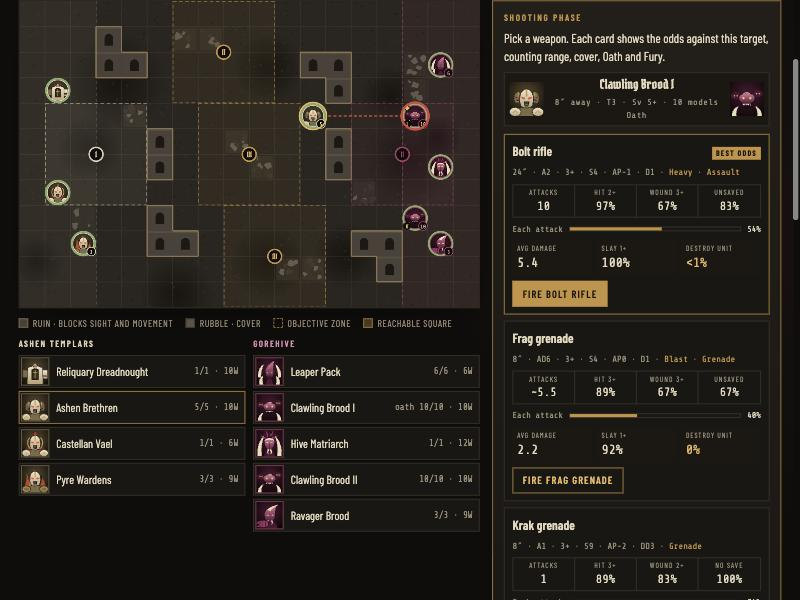
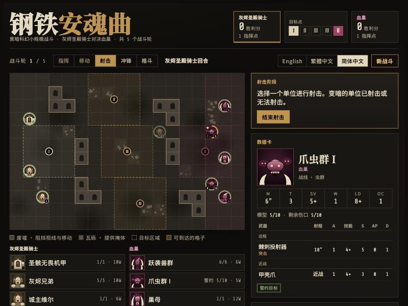

# Iron Requiem

A turn-based grimdark sci-fi skirmish game that runs in your browser. Lead the **Ashen Templars**, a small elite force, against the **Gorehive**, an AI-controlled xeno swarm, across a ruined battlefield.

**▶ Play it:** https://hxcsyxc.github.io/iron-requiem/

Available in **English · 繁體中文 · 简体中文**.



## Features

- **Tabletop-style turns.** Each turn runs Command → Movement → Shooting → Charge → Fight on an 18 × 12 grid (2″ squares). Ruins block line of sight and rubble gives cover.
- **Real dice.** Every attack rolls to hit, to wound (Strength vs Toughness) and to save (modified by AP, cover and invulnerable saves). Each die shows up in the dice tray.
- **Weapon choice with odds.** Most units carry 2–3 weapons. Pick a target and every weapon card shows the chance to hit, wound and get past the save, the chance per attack, the average damage, and the chance to kill a model or wipe the unit. The last two come from simulating the attack 1,200 times.
- **Weapon rules:** Rapid Fire, Heavy, Assault, Torrent, Lethal Hits, Blast and Grenade.
- **Stratagems and army rules:** Oath of Ash (re-roll hits against one enemy), Unyielding Fury (+1 to wound), Command Re-roll, battle-shock, and Synapse for the swarm.
- **Objectives and scoring:** five objectives controlled by Objective Control, 5 VP per objective each turn from round 2, +5 VP for killing the enemy warlord, five battle rounds.
- **AI opponent** that advances, takes objectives, chooses the best weapon and target, charges, and spends CP.
- **Original art.** Every unit has a hand-drawn SVG portrait, used on the board pieces, datasheets and roster.
- **Three languages.** The whole game is translated, including the battle log and rules, and you can switch mid-game.

## Run locally

It's one file with no build step. Open `index.html` in a browser, or serve the folder:

```bash
python3 -m http.server 8000
```

Then visit http://localhost:8000.

## Project layout

| Path | What it is |
|---|---|
| `index.html` | The whole game: rules, AI, rendering, art and translations |
| `tools/make_hans.py` | Rebuilds the Simplified Chinese table from the Traditional one |
| `docs/` | Screenshots |

### Editing translations

English and Traditional Chinese live in the `STR` tables in `index.html`. Simplified Chinese is generated from Traditional Chinese, so edit the `zh-Hant` table and then run:

```bash
pip install opencc-python-reimplemented
python tools/make_hans.py index.html
```

## 中文簡介

《鋼鐵安魂曲》是一款在瀏覽器中遊玩的回合制黑暗科幻小規模戰鬥遊戲。你將指揮灰燼聖殿騎士，對抗由電腦控制的血巢蟲群。遊戲包含命中、致傷、豁免擲骰，可選擇武器並顯示勝率，支援英文、繁體中文與简体中文。



## Disclaimer

A fan-made game inspired by grimdark tabletop wargames. It is not affiliated with or endorsed by any game publisher. All factions, names, art and rules are original.

## License

[MIT](LICENSE)
